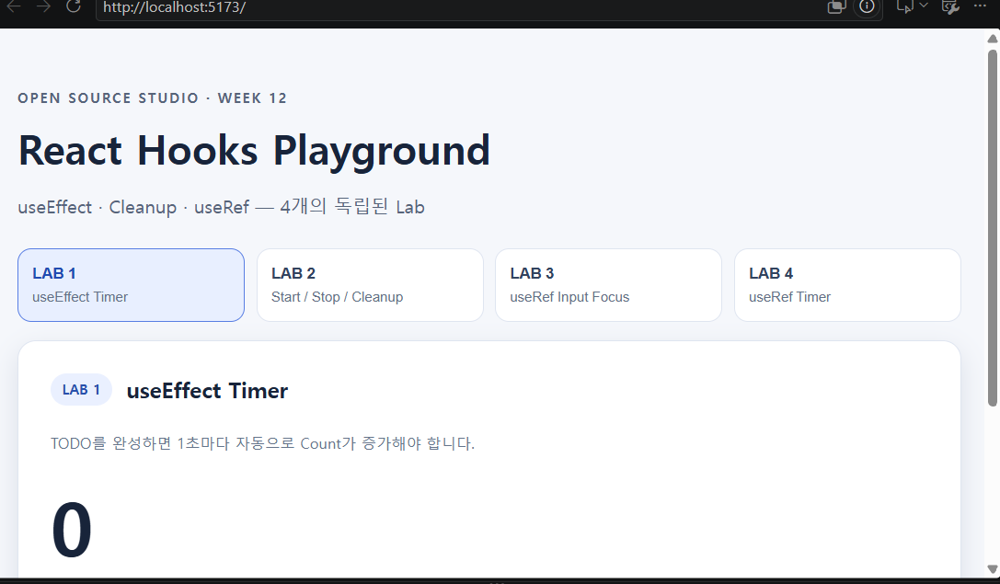
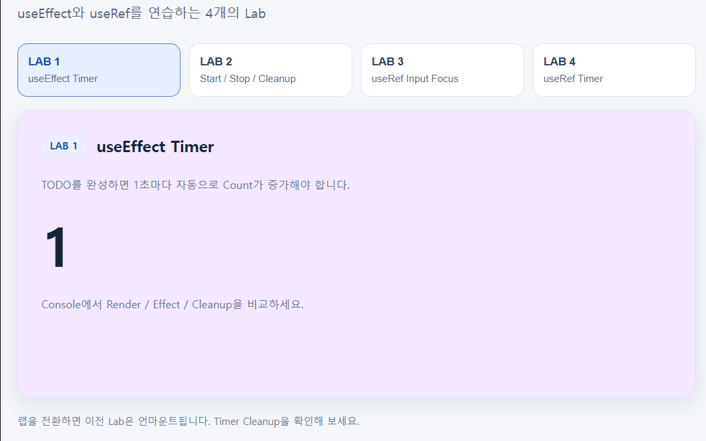
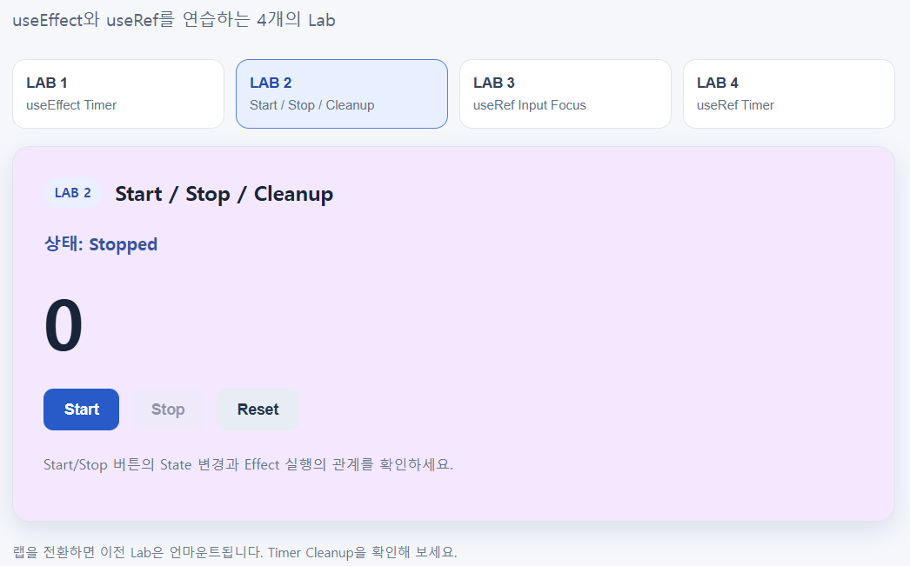
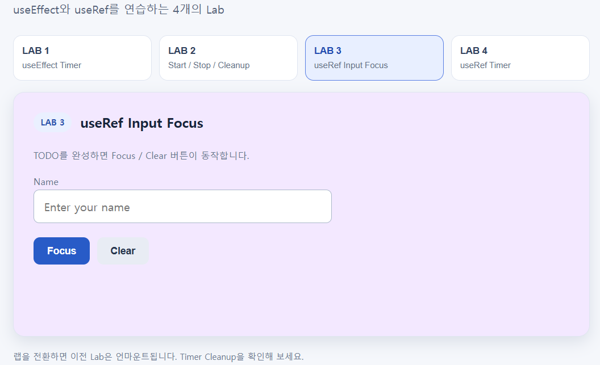
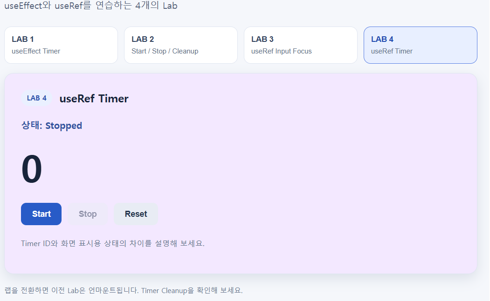

1. 프로젝트 소개

- React의 useEffect와 useRef를 사용하는 프로젝트
- https://github.com/2026-2-OSS/week12_starter_project

2. 실행 방법

npm.cmd install

npm.cmd run dev

3. 소스코드 분석

- App.jsx: 전체 화면 및 LAB 선택
- App.css: 화면 디자인
- components: LAB 1,2,3,4 기능
- useEffect: 조건에 따라 코드 실행
- Cleanup: 타이머 정리
- useRef: 값이나 HTML 요소
- useState: 값 변경 시 화면 다시

코드 1 - useEffect

useEffect(() => {
    const timer = setInterval(() => {
    setCount(prev => prev + 1);
    }, 1000);

    return () => {
    clearInterval(timer);
    };
}, []);

설명: 1초마다 Count를 증가시키고 Cleanup으로 타이머를 정리

코드 2 - useRef

const inputRef = useRef(null);

const focusInput = () => {
    inputRef.current.focus();
};

const clearInput = () => {
    inputRef.current.value = '';
    inputRef.current.focus();
};

설명: 입력창에 커서를 이동하거나 입력한 내용을 지움

4. LAB 구현

- LAB 1: 1초마다 Count 증가
- LAB 2: Start, Stop, Reset 구현
- LAB 3: Focus, Clear 구현
- LAB 4: useRef로 타이머 관리 및 Cleanup

5. LAB 비교 분석

1) Dependency Array: Effect가 다시 실행되는 조건을 정한다.
2) Cleanup: 없으면 타이머가 중복 실행될 수 있다.
3) useState와 useRef: useState는 값 변경 시 다시 렌더링하지만 useRef는 그렇지 않다.
4) LAB 2와 LAB 4: LAB 2는 running State와 useEffect, LAB 4는 useRef로 타이머를 관리한다.

6. Customizing

- App.jsx: 한국어로 변경
- App.css: 하늘색, 연보라색으로 변경

7. Deployment

Vercel: https://week12-starter-project-henna.vercel.app/

8. Weekly Review

새롭게 배운 내용

1) useEffect로 타이머 실행
2) Cleanup으로 타이머 정리
3) useRef로 타이머 관리

어려웠던 점과 해결 방법

- 처음에 코드를 이해하고 뭘 해야하는지 알아보는 것에서 어려워서 오래보고 ai에게 물어보기도 하면서 코드를 이해하고 무엇을 하고 어떻게 작성해야하는지에 대해 알게 된 것 같다.  

AI 활용

- 처음에 코드를 이해하고 뭘 해야하는지 알아보는 것에서 사용했고 내가 작성한 내용이 맞는지에 대해서 확인하면서 사용했다. 
- 오류가 일어났고 오류가 왜 일어났는지 확인하면서 ai를 사용했다. 
